#+title: 20.24 Role Expansion and Source Authentication Boundaries
#+language: en
#+filetags: :modules:performance:currentness:evidence:

* Question and measured path

Use the existing 256-declaration Case to explain the remaining work before
another capacity run. This is graph construction, not library compilation or
business-scope loading. The existing 10000-module Case, 2 GiB budget and timeout
remain unchanged. No capacity acceptance follows from this investigation.

The maintained test observer now emits its existing bounded phase/guard/owner
table without enabling the full retained-object census. It stores at most 1024
scalar rows, forwards every event to the previous observer, and authorizes no
source reuse. It retains no source bytes, compiler contexts or admission result.

The actual 256-declaration run reproduced exactly 79339 physical source reads:

| Physical-read phase | Caller boundary | Reads |
|---------------------+-----------------+-------|
| publication-current | declaration-before | 10240 |
| publication-current | declaration-inputs | 11520 |
| publication-current | source (two deferred-role guards) | 23040 |
| publication-current | declaration-after | 11520 |
| publication-current | candidate-admitted | 11520 |
| publication-current | graph-current | 3195 |
| compiler-import | outside-guard | 3846 |
| source | outside-guard | 2564 |
| source | source | 512 |
| eligibility | outside-guard | 256 |
| declaration-before | declaration-before | 256 |
| declaration-inputs | declaration-inputs | 256 |
| declaration-after | declaration-after | 256 |
| candidate-admitted | candidate-admitted | 256 |
| compiler-tools | outside-guard | 97 |
| graph-current | outside-guard | 3 |
| graph-before | outside-guard | 1 |
| link-current | outside-guard | 1 |
| Total | | 79339 |

Thus candidate publication-current checks account for 67840, graph
publication-current for 3195, and the remaining phases for 8304. Do not infer
the count by multiplying six guards by one assumed closure size: the initial
location/declaration window already shares observations.

There are 512 actual expanded/evaluated bodies: one interface and one demanded
Types body per module. The 768 reader-declaration events include declaration
metadata events and are not 768 evaluated modules. The 1024 inert role parses
are another count. Config/Objects and unselected Features remain unforced.
The worker retains the real scope-Contract preflight; removing Types from this
Case would change the workload rather than improve its implementation.

* Concrete boundaries in the production reader

| Entry | Work crossed before the next guard | Reuse decision |
|-------+------------------------------------+----------------|
| read-publication entry | location/policy and wrapper preparation | Preserve the existing private location window; no whole-publication window |
| declaration-inputs | runtime import/expansion and initialization | Fresh check after initialization |
| resolve-role entry/exit | Type import, evaluation and value extraction | Keep both checks; these calls may execute extension code |
| declaration-after | consume and publication Contract admission | Keep candidate-admitted independently |
| candidate completion | original issued-read replay and outer graph publication | Preserve ordered replay and final source checks |

=module-source-read= already reuses raw bytes by path inside the existing
dynamic read window. =check-source-current!= separately preserves each expected
value and its diagnostics; collector enrollment is not equivalent to byte reuse.
=admit-compiler-inputs!= uses the demanded runtime dependency index, rather than
walking every selected module. None of these observations establishes that two
separate windows may share bytes across an opaque callback.

In particular, neither a hot POO slot nor a stable runtime module-context identity
proves that its backing source file has not changed. Replacing fresh source IO
with those identities would remove the source-change negative control.

The main group is not declared irreducible. A further reduction needs a concrete
pair of adjacent checks with no intervening effect, or a runtime ownership rule
that establishes the required read-only interval. Phase totals alone prove
neither condition. Do not broaden the window on the strength of these totals.

* SysML allocation: reuse existing proofs

SysML owns the production-boundary allocation above. No second state model or
cache protocol is introduced.

- Lean =Admission/SourceWindows.lean= owns =check_exact=, =fresh_exact=,
  =two_requirements_one_read= and =changed_source_rejected=. These establish
  value reuse under a sound, stable-world window, not purity of Scheme callbacks.
- Its =child_misses_parent= and =final_value= reuse LeanPoo ContextSlot to state
  receiver separation. They do not authenticate file bytes.
- Existing Quint =SourceWindows= owns the temporal counterexamples: cross-effect
  reuse, omitted requirements, parent receiver reuse, eager branches and missing
  final authentication. Keep these matched negative cases; do not duplicate the
  static Lean cache equations in another Quint model.
- Runtime tests own the correspondence to real MOP records, callbacks and files:
  =source-observation-test= and the real Gitea/PostgreSQL publication Scenario.
  Their success does not turn an arbitrary source observer into a pure function.

* Evidence and remaining gate

Validation on this source revision:

| Existing gate | Result |
|---------------+--------|
| Runtime Core build, separately invoked | passed |
| just test-file t/module-declaration-retention-test.ss | parent and actual worker MODULE-OK / HARNESS-OK / OK |
| just test-file t/gitea-postgresql-publication-test.ss | 11 Cases, MODULE-OK / HARNESS-OK / OK |
| just test-file t/source-observation-test.ss | 6 Cases, MODULE-OK / HARNESS-OK / OK |
| lake build YuanxuProof.Admission.SourceWindows | passed, 47 jobs |
| Existing SourceWindows Quint qualification | all 8 matched positive/negative gates passed |

The first Quint invocation was blocked before model checking because the sandbox
denied a loopback-port bind. The authorized rerun used the same model, checker,
cases and limits; its seven expected counterexamples count as successful
negative controls, not passing system behaviors. No new Python layer was added.

Local raw receipts remain outside source control under
=/private/tmp/yuanxu-entry-local-20261026/source-window-*=. The attribution run
passed MODULE-OK, HARNESS-OK and OK. It retained 273751424 live bytes after the
worker's GC. Graph-ready elapsed/CPU measurements were 41.607/36.767 seconds;
the added diagnostic table and host scheduling prevent treating comparison
with the earlier 33.975-second run as an optimization result. Build execution
was a separate runtime build invocation and was not included in this graph run.

The qualified runtime in this run remains gerbil-poo b5cf9e8 with the
previously recorded local issuance protections. Upstream PR head 9d5d9d0 was
fetched and reviewed: 13d01ad fences checked declaration reads/writes after
validator callbacks; 89febc8 separates public C3 snapshots from canonical state.
Neither has been claimed runtime-qualified by this receipt. The Core dependency
pin was not silently changed, and no Gerbil compiler source was modified.

This iteration adds production-path attribution, not a claim of reduced source
reads or closed scale design. Before the capacity rerun, qualify any proposed
window change against the actual callback trace and current upstream protection
set. Preserve both competing port requirements, parent/child cache separation,
source-change refusal, observer order and unselected-branch laziness. Do not
cache an admission verdict, widen the resource budget, or publish this work yet.

* Compiler metadata: constructor association and closed prefixes

The implementation boundary is the existing Reader/preparation/Link/build
pipeline, not Make scheduling. =preparation.ss= delivers its actual checker and
bound input-state function to the constructor's consumer. The Reader reuses its
existing eq? input association: Context -> input, input -> constructor binding.
Original bindings therefore do not depend on a filename's latest preparation.
The latest derived view stays bounded by path, while Link binds its exact state
function before a later derivation can replace that last view. Neither entry records a successful
admission or source-currentness result.

Repeated package checks compare current bytes and the official expander's
package value with the datum parsed at preparation. They no longer parse the
same expected text on every guard. Before a shared interval, qualification
inspects the installed expander's existing =__module-pkg-cache= through its
native table route. A missing or replaced cache entry selects the original
independent path; it never invokes the package reader to establish purity.
This internal state probe is tied to the installed Gerbil API. It is not a
second package resolver, registry or public package interface.

Qualification also requires unchanged constructor/receiver/prototype state,
actual warm checker identity, compatible selected input identity and no open
observer/protocol. Native replay traverses the original issued dependency roots.
A protected cache-miss on an input or entry prevents sharing: computing metadata
must not invalidate an earlier absence record.

The compiler inventory and selected-source-view loops use the Graph-owned
metadata interval. Retained foreign entries fall back. The final selected
publication stays outside the shared prefix. Import, Make and native output
writes remain separate boundaries. Primitive Scheme data use native =write=;
opaque/cyclic values use the same writer through the existing callback boundary.
Exceptions clear enclosing observations before their original cause propagates.
An opaque callback closes the existing prefix for the remainder of that extent;
clearing bytes alone would wrongly trust guards/observers replaced by its body.
No guard occurrence, dependency, requirement or observer event is deleted.

Lean =BoundaryComposition.SourceGuards= checks actual-origin correspondence,
constructor/checker/ancestry replacement, cold package lookup, protected misses,
open contexts and observers. =ReadOnlyEntry= supplies ordered replay and first
failure laws; =SourceWindows= supplies stable-byte reuse. Existing QNT models
supply temporal negative controls, rather than duplicating static origin laws.
The correspondence still trusts installed primitives and the stable serial
interval; it does not prove arbitrary FFI writes or an atomic filesystem snapshot.

Reproduce with the existing entrypoints, serially:

#+begin_src sh
just build-core
just test-core-file t/module-build-role-test.ss
just test-core-file t/source-observation-test.ss
just test-core-file t/module-candidate-stage-test.ss
just test-core-file t/gitea-postgresql-publication-test.ss
#+end_src

Keep matched build receipts outside Org. A failed positive sharing assertion is
not a performance pass; neither a warm-only repair nor changed-source runs form
a cold/hot pair. This boundary does not discharge the capacity Case.

The Reader capability slots deliberately use distinct lexical function names.
A same-name right-hand identifier in a POO slot is a self read, not a reference
to the outer function. Inspect generated Scheme when establishing this binding
correspondence. Qualification failure must keep independent guards; it must not
silently become a claimed successful optimization.

Every Link guard still executes its issued-record replay. Do not memoize the
whole =check-current!= call in the byte table: doing so would reuse MOP admission
along with bytes. =closed_window_keeps_authentication_trace= instruments the
existing ordered executor and preserves operation occurrences through the first
failure. Runtime controls compare replay call and visit counts while comparing
physical reads. A foreign entry ends a segment; its successor must recheck the
actual captured entry revisions, including change-and-restore.

* Selected compiler instances retain their own constructor association

A retained library input and a later Reader input can name the same file while
owning different guard closures. Do not assert procedure equivalence. Native
constructor capture supplies =module-source-input-state=: a fresh validator of
actual receiver/prototype revisions, cached guard identity and package-cache
state, never an admitted-byte result. Link retains the exact derived binding;
lookup through a mutable "latest filename" cache is insufficient.

The Graph reuses its existing identity index for constructor-bound input states.
The projection reuses its existing entry-identity index for selected entries and
compiler-identity state bindings. =compiler-source-inputs= still owns one extent;
its rows carry the same input plus the projection's private constructor-derived
validator. No object-supplied =source-state= property is trusted. No restoration
store, signature system or second source-cache lifetime is introduced.

=SourceGuards.selectedNative= checks the selected input against its own origin.
=distinct_selected_keeps_both_bodies= appends both original programs in order.
The open-context, changed-receiver, changed-checker and changed-revision lemmas
refuse unsupported associations. Existing QNT checker/scope-reuse controls own
temporal replacement, not a duplicate constructor-binding model. The Scheme
correspondence trusts the Core-owned capture call sites and installed primitives;
this is not a sandbox for arbitrary callers of internal low-level APIs.

The role test uses the real projection for both a Graph role and a retained
library. It covers distinct same-file closures, counterfeit properties, nested
scope restoration, open observers and revision change-and-restore. Compiler
artifacts and metadata snapshots remain separate: a state validator can qualify
read-only execution while the actual byte guard still rejects changed source.

* Scope owner and the actual replay entry

Compiler input rows also retain their projection's Graph receiver. The private
producer compares that owner with its original returned Graph and checks the
Graph's captured revisions before each closed segment. A derived Graph cannot
inherit its parent's read-only authority; in-place replacement invalidates the
snapshot. The role test checks that a claimed state callback is not called when
the inherited owner differs. Lean =inherited_graph_owner_refuses= and
=changed_graph_refuses= own those identity/revision conditions; existing Quint
parent/scope-reuse controls own their temporal failures.

For the pinned gerbil-poo v0.1.2 producer, inspect
[[https://github.com/tao3k/gerbil-poo/blob/a84e76c1b1a61de2db52e38ba8d1d8c8671ec601/object/observation.scm#L9-L28][object-read-current? and its issued checker]]: issuance and the pinned metadata
route precede raw revision, instance, cache-presence and value comparisons. The
bootstrap branch reads an anchor value; it does not invoke that hook. The current
checker does not compute a cold C3 order or call a user getter.
[[https://github.com/tao3k/gerbil-poo/blob/a84e76c1b1a61de2db52e38ba8d1d8c8671ec601/object/observation.scm#L159-L167][replay-slot-reads!]] uses that issued traversal with a fixed Core visitor under
=without-observation=. Its native owner performs final authentication. Source
window qualification never fabricates a replacement dependency bundle.

This is a correspondence to the installed producer source, not a claim that an
arbitrary exported procedure named =current?= is pure. Native table routes,
serial execution and Core-owned capture call sites remain explicit premises.
Imports, opaque callbacks and effects retain their original fresh boundaries.

* Build evidence and the compiler handoff

The official =build-script= =spec= dispatch can isolate preparation from Make:

#+begin_src sh
GERBIL_BUILD_VERBOSE=2 gerbil env ./build.ss spec
#+end_src

It uses the existing script's watchdog and does not compile. Its counters cannot
qualify the compiler-input interval: only =compile= enters that scope. Reproduce
the actual handoff through =just build-library= after =just build-core=; use the
normal =just build= for package acceptance. A preceding timeout leaves a recovery
build, not a cold/hot pair. Compare the same source cohort and require natural
completion before reporting either pair.

Read-attempt counters are inclusive of nested operations. Do not add them as
independent I/O. Compare physical reads together with original guard occurrences
and native replay visits. In particular, a lower =link-current= physical count
does not discharge publication admission: opaque role imports, policy calls,
Make and the independent final boundary still own their checks. A successful
metadata-only control is not evidence that the product's compiler path closed.

* Core architecture views

The qualified branch requires the actual constructor, receiver/revision,
selected-owner, route and observer conditions described above. Its issued-DAG
operation preserves every authentication occurrence and return check. The fresh
tail is outside byte reuse. Effects include imports, policy/Contract callbacks,
Make and observers; unknown or changed state retains independent checks.

SysML allocates boundaries. Lean/LeanPoo owns structural refinement and ordered
execution laws. Existing Quint cases own mutation/callback traces and negative
controls. Scheme tests establish actual state extraction and consumer behavior;
only actual build/runtime measurements establish performance. These diagrams
use authored POO design facts. The existing D2 Module derives visual rows through
ASCENT and serializes D2; this is not generated proof or benchmark evidence.

Generated D2 lives beside these SVGs; the authored inputs are =dev/d2/architecture.ss=. Reproduce through the existing product
renderer as documented in [[file:../../d2/README.org][Core diagram organization]]. Core owns no TS toolchain.

* Requalify the source-only suffix after a publication fence

The old batching path shared a prefix before the final publication, then passed
that publication and the entire remaining source suffix to independent checks.
A batch can contain many source entries after its last publication. That source
suffix is not automatically an effect boundary, nor is its read-only eligibility
a consequence of the preceding prefix.

Keep the original entry order: close the prefix, execute the publication's
original guard freshly, then requalify the remaining owned suffix using the same
Graph/Reader/MOP conditions. Share only the new qualified prefix; its last input
still executes freshly. Changed state, observers and foreign entries retain the
independent route. Imports and Make stay outside both intervals. This neither
moves the publication check to the end nor retains an admission verdict.

Lean =blocks_keep_first_diagnostic= executes the existing =ReadOnlyEntry.execute=
with fresh bytes at each block boundary. It preserves the first fault of the
flattened ordered program; =publication_suffix_keeps_diagnostic= specializes the
publication-fence/source-suffix/final-input split. Protected receiver and file
identity follow =execute_preserves_protected=. Per-operation trace preservation
still follows =closed_window_keeps_authentication_trace= within each qualified
block. These laws require actual callback-free lowering and stable files inside
each block, not across arbitrary callbacks.

Existing =SourceWindows= Quint controls retain cross-effect source changes,
missing requirements, parent/child separation, eager branches and omitted final
checks. No duplicate temporal model is introduced. The role regression uses real
Graph source roots after a publication fence, compares original entry identities
and order, and retains replay calls/visits. Product build evidence is required
before claiming a whole-workflow benefit.

The source-only suffix may contain inputs constructed by Graph rather than
Reader. Its existing native identity index owns those constructor-bound states.
Pass that private binding into the same Link qualification function; querying
only Reader origins falsely classifies such inputs as unknown. This is not a
new registry, public purity property or alternate lifetime. The callback is an
existing Core constructor-owned binding, and all original receiver/revision,
package-cache, selected-owner and protected-miss checks still apply. Arbitrary
low-level callers are outside this construction-correspondence premise.

A hot build with unchanged source inputs is a runtime measurement, not a matched
cold/hot pair if the preceding build repaired outputs. Compare physical source
reads as well as wall/CPU and replay work; faster replay does not establish that
whole-source-closure I/O was eliminated. Use local receipts, not tables of raw
run output in this design document.

* One native warm import, two original guards

The compiler hook already checks its input before and after the official import.
A native cache hit returns the existing context without expanding source. This
permits byte reuse within that request only when both the native import route
and the existing Reader/Link read-only qualification are established. It does
not permit omitting either guard, caching a verdict, or extending the interval
through module evaluation or Make.

This correspondence covers the fixed action constructed by Core's compiler
hook: original guard, official import, original guard. The internal method's
action argument is not a general permission to classify arbitrary user code as
read-only. Direct low-level invocation with a foreign action is outside this
producer correspondence, just as arbitrary private-registry writes are.

The existing compiler-input row now retains its original publication Entry.
Use that Entry's already-indexed path, its cached input identity and its actual
Graph owner. Reading a cold =input.path= merely to establish eligibility would
introduce computation into the classification. No parallel field table or
registry is needed. Unbound sources, cold contexts, inherited owners and
foreign import procedures keep independent checks.

The internal =.with-compiler-source-import= method closes any enclosing byte
window before the request. It requires the actual =core-import-module= procedure,
the expected cached native context identity and the unchanged constructor-bound
state. The original action still calls the official importer between its two
original guards. Source and slot observers, protected misses and changed MOP
routes continue to prevent qualification. Each subsequent request starts fresh.

Lean's =native_warm_import_is_empty= and =warm_module_omits_expansion= relate the
native cache branch to LeanPoo's existing =lookupOr_present=. The foreign/cold
theorems retain an opaque boundary. =warm_import_keeps_guard_diagnostic= preserves
the first ordered diagnostic across both guards. =native_puts_keep_warm= requires
that native writes to the same path preserve the expected source identity.
The installed expander's string-path registration happens after expansion;
prelude/context and library-symbol entries have distinct keys. This audit is a
source correspondence, not authority over arbitrary low-level writes to the
private registry. Unsupported concurrent mutation and filesystem atomicity
remain explicit premises. Existing =SourceWindows= and =ReadOnlyEntry= Quint
cases own temporal mutation and final-check controls; they are not duplicated.

Reproduce the extraction controls with =just test-core-file
t/module-build-role-test.ss= from the product root. They compare two warm native
requests against independent original guards, retain replay counts and visits,
and check parent ownership and a foreign importer that mutates its source.
Run =just test-core-file t/gitea-postgresql-publication-test.ss= for the real
domain chain. Build =YuanxuProof.Admission.BoundaryComposition= using Lake and
qualify the existing Quint case prefixes =SourceWindows= and =ReadOnlyEntry=.
Record physical reads, =compiler-metadata-preflight= cost, CPU and wall time in
local artifacts. A reduction in this control is not a whole-product result.

For a clean product measurement use the default order: =just clean=, then
=just build= (Core before the product library), then =just build= again for the
hot measurement. Account for Core and product phases separately. A direct
=just build-library= after cleaning does not establish its Core module
prerequisites. Keep that failure as a failure, not a cold result. Compare source
cohorts before and after both measurements, count actual compiler jobs, and
retain the existing heap and time budgets. Never infer a matched before/after
optimization result from an older run whose parallel production edits differ.

* Graph-owned source guards use the same request boundary

The publication branch needs the complete Reader/Link qualification because its
guards can reach the observed publication closure. A plain source created by
Graph's =prepare-build-source= with the native =void= context has a smaller,
constructor-defined support: source bytes, package snapshot, and the native
package-cache association. Its guard has no Link traversal or user callback.
Do not pay for an unrelated whole-Link preflight to share that guard's bytes.

Use the existing Graph =by-id= constructor association, not =kind: 'source= as a
purity claim. Require its live state validator, exact cached checker, actual
receiver/ancestor revisions, native read route, warm package association and
original compiler owner. Reader-derived/unbound inputs retain independent
checks. Both original calls still run; only their source bytes share the
existing request-local window. Every next request starts fresh, and cold or
foreign imports still close the window. No new registry or admission cache is
introduced.

Observer compatibility is checked before entering =without-observation=.
Otherwise that classifier would erase the very foreign observer whose presence
must prevent sharing. The source regression installs a real slot observer,
checks delivery and both guards, and requires zero shared-input requests there.
The existing parent-owner and foreign-import mutation controls remain active.

Lean =void_context_uses_source_requests= identifies the constructor program;
=owned_input_keeps_both_guards= combines actual-origin extraction with exact
trace and first-diagnostic preservation for the two original programs. These
are specializations of the maintained LeanPoo/window model, not a new purity
annotation. Existing =SourceWindows= and =ReadOnlyEntry= Quint cases continue
to own cross-callback mutations, parent isolation and final-check counterexamples.
Runtime tests establish the constructor/state correspondence. Stable serial
files and the supported native metadata route remain premises, not an external
filesystem transaction guarantee.

The publication-boundary diagram's Guard DAG node denotes publication guards.
It does not require a whole-Link DAG preflight for these source-only inputs.

The runtime control uses the actual unified compiler view's enrolled Make
descriptor. Importing an ordinary original source path remains Gerbil-owned;
do not intercept it just to make the optimization test pass. Native import still
returns that original source's context, not the descriptor as a second library.

Keep the Module tree separate from its package kernel. A declared Module owner
is resolved first. An unowned file inside that tree is a public dependency and
must retain native identity/load-path checks; sharing its package root does not
grant private-source authority. Ordinary package libraries outside the Module
tree, such as built-in Ops, retain the existing kernel route. The control for
selected compiler sources removes the ambient root, checks the selected extent,
then requires refusal after that extent ends. This remains independent of byte
reuse, and its failure blocks a performance qualification.

* Bound compiler sources and stage attribution

The existing compiler-tool input index binds an actual native context to one
normalized owner path and its constructor's expected source/package observations.
When that binding is inside the requested source owner, reuse the path and run
the original checker on every demand. Do not resolve and parse the complete
source again just to derive an already bound identity. A missing or changed
bound file must raise that checker's error; it must not become an optional
dependency omitted by a fresh resolver. An absent or foreign-owner binding
retains the original resolver. This is the existing weak identity index, not a
new cache of admission results. The outer native-context identity/path checks,
callback guards and final currentness remain necessary.

Lean =checked_snapshot_keeps_metadata= states the deterministic projection law
over the complete registered source/package observations. The bound-source
return/rejection laws retain the original checker result. These laws require
the fixed installed compiler and the actual constructor/context association;
they do not authenticate a context by its printed name, invent a header-only
check, or cover arbitrary mutation of compiler-private bindings. Existing
=ReaderEffectSupport= Quint cases own complete entry/return support, mutation,
cleanup and rejection controls. Existing =SourceWindows= and =ReadOnlyEntry=
retain the narrower byte-window obligations. Do not duplicate their temporal
models in Lean.

Build measurements must distinguish native context loading from source expansion.
=BUILD-EXPANSION= is the historical census label for newly registered context
instances. Its number alone does not count macro expansions or compiler jobs.
The same phase-local census now reports same-identity contexts and bounded
context/path samples. Different generated identities can still denote copies
of one original source, so zero identity mirrors is not proof of no duplication.
This diagnostic index grants no import authority and outlives no phase.

For example, a selected role can produce a private reader context for the same
original source that the package library lists as an ordinary Make target.
Sharing between those contexts needs evidence of the original source, phase,
defining binding and initialization behavior. The role Prelude can publish its
own =.def= while keeping the POO binding internally. Lean's
=renamed_export_keeps_reference= and =role_export_is_not_internal_lookup=
capture that distinction. Keep separate contexts when these conditions are
unknown, and retain the original source checks on both paths.

The Session selector is a concrete negative case for source-path sharing.
The ordinary package target is =agentic-ai-lab/modules/session/selector=.
The Reader gives its copy the same package parent and a private namespace
ending in an ordinal and =selector=. The file exports record operations and
defines =agentic-ai-lab-session-selector-receipt-record= with =defstruct=.
Replacing the private context with the library context substitutes the
defining namespace of these bindings. The current Reader rejects registering
a captured compiler tool as a private source. That check must stay in place
until a replacement preserves the actual lexical and initialization semantics.

Lean's =same_source_distinct_binding_separates= excludes reuse when a
defining binding differs, even with the same source. The model also requires
phase, initializer and ownership agreement. Its
=context_reuse_keeps_rejection= theorem retains the original checker on a
matching route. The model assumes those identities have been established by
the runtime. Quint's existing =ReaderEffectSupport= model covers the separate
temporal obligation: the original support must be checked around initialization
even if an initializer changes a source outside its declared runtime imports.

The Gerbil control imports the original Selector and a copy with the Reader's
package-parent and private-namespace arrangement. The two resolved receipt
predicate bindings differ at phase zero. Forcing both module bodies reports
separate phase-zero compile and successful evaluation events. The control
exercises namespace separation independently of the Reader's admission logic.

Source preparation can still share the private, ordered package observations
for a common ancestor directory. =package-directory-snapshot= uses the existing
source observation window. Negative entries before the common ancestor remain
in the list. Open observers traverse the directory chain in the original order,
and callbacks end the observation window. Body expansion, initialization,
receiver identities and admission results stay independent.

* Reject foreign package searches before entering the resolver

Compiler-source projection receives native contexts from several packages.
The fallback resolver temporarily narrows Gerbil's load path to one declared
package root. Gerbil skips that directory when its registered package prefix
differs from the requested library name. Reject that empty search before
changing the load path or raising a resolver exception. Apply this only after
the existing bound-source and configured-language branches. An unregistered
directory or a matching prefix still uses the original native lookup and
validates the returned source identity. Each independent demand still resolves
against the current native package state.

Lean =foreign_directory_has_no_candidate= and
=bound_language_precedes_directory= describe this branch order. Quint
=SourceWindows= owns the separate temporal conditions for source checks,
callbacks, and the final receiver. The prefix rule changes neither the
support of a selected publication nor the order of its currentness checks.

The guarded-source read counter excludes Gerbil's native parser/import I/O.
Report =reader-bound-source-reuse= and =reader-owned-source-resolution= separately
from successful guarded byte reads, compiler jobs, and whole-process elapsed
time. Native source parsing is not made visible by renaming a guard counter.
Keep the library-spec and selected Module projection clocks separate. Stable
compiled-runtime/source cohorts are required before comparing cold and hot
builds; a concurrent reader change invalidates that comparison.
