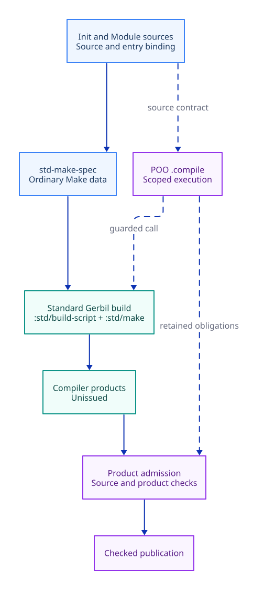

#+title: 20.37 Standard Gerbil Build Ownership
#+language: en
#+filetags: :build:ownership:currentness:

#+attr_org: :width 1100

Diagram source: [[file:20.37-standard-gerbil-build-ownership.d2]].

* Responsibility allocation

| Owner | Responsibility |
|-------+----------------|
| Init and Module declarations | Select source owners and expose an ordinary Make specification |
| :std/build-script | Define the package entry and interpret standard build commands |
| :std/make | Resolve compiler dependencies, schedule actual cores, compile and clean |
| Module declaration syntax | Import adjacent roles and export the publication through the original source |
| Config module | Export its authored Config value through the native module system |
| Existing source projection and publication APIs | Enforce their explicit source/spec/product contracts; package build success grants no authority |

The Yuanxu =module-system/building/script.ss= macro is removed. Production and
test declarations import =defbuild-script= from =:std/build-script= directly.
Do not replace the deleted macro with an alias, new dispatcher, CLI flag parser
or implicit consumer registration. The existing spec producer accepts an optional explicit entry-source, passed
from the standard build entry with =this-source-file=. The source owner retains
the build.ss byte binding without discovering an implicit CLI consumer.
A native module test imports
=:std/source= when it needs the standard macro's source anchor.

The first direct build exposed undeclared Module syntax; the next exposed
missing Config exports. Those failures are retained locally. Explicit imports
in the five production Module/Scenario interfaces and explicit Config exports
in the three Scenario Config modules make the authored sources independently
compilable. The complete standard package build then passed at actual host
compiler capacity; no dependency pin or deadline changed.

The earlier migration left an implicit consumer registration and command
adapter behind =call-with-init-build-spec=, and Weaver still used it. That
residual API and its dispatcher are now removed in Yuanxu. The experimental
Weaver edit was reverted to honor the Yuanxu-only scope; that external caller
has not been migrated or qualified. Explicit POO artifact issuance keeps
its source/spec/product contracts, independent of native package compilation.
Migrated consumers and refusal controls still require complete qualification.

* Validation obligations

- Execute the original complete build through =gerbil build=.
- Keep native source anchors and single evaluation of Make values/options.
- Verify real compiled namespaces and executable consumers.
- Retain stale-source, altered-spec and missing-product refusal controls.
- Run all four build-input mutations and before/after controls.
- Follow exact-head Ubuntu and Darwin CI; a local build is not full acceptance.

All raw transcripts stay in ignored local cache storage.

* One native package identity

The implementation and the public =:tao3k/yuanxu/prelude= share the
=tao3k/yuanxu= package prefix. This is a package declaration, so
Gerbil can derive the same identity from the original source and its Make
target. The root build uses the same native =defbuild-script= and one
ordinary Make list. Independent consumers can choose the prelude or
import =yuanxu!= from the declaration module.

The former mixed-prefix build predicted a different prelude output than
the compiler emitted, causing a supposed no-op to compile it again.
Keep the original cold, no-op, cleanup and unselected-output checks,
including the actual compiled interface's native identity.

The real program test passed through both the official package build and the
explicit POO issuer. It rejects the first unissued program, accepts the scoped
standard-main result, and retains executable tampering, unknown-program and
stale-source refusals. All four input mutations and both surrounding controls
passed. Full cold/hot/clean acceptance remains independent of these results.

* Native test coverage

The source-entry, specification, reader-tool-context, source-snapshot and public
dependency-readiness suites now acquire the existing selection fixture through
standard =test-setup!= / =test-cleanup!=. Their cases no longer silently disappear
when an external qualification variable is missing. Fixture paths are canonical
before source-membership checks, and release restores the original load path
and package prefix even when cleanup fails.

These five suites passed as independent =gerbil test= invocations. The reader
suite checks the selected =json-schema= identity and every one of its eight
compiler-role identities, then retains changed-tool, removed-tool, foreign
same-identity and cyclic-import refusals. A historical minimum row count is not
an assertion about the selected closure.

The process-level cold/hot/clean suite checks actual compiler output identity,
modification times, selected product removal and unselected-output retention.
It does not require accounting text from the deleted CLI adapter. The existing
source-currentness and four mutation suites remain separate mandatory gates.
The source-spec clean check and process no-op check still expose the locked
compiler's identity/cleanup gap; neither is recorded as passing.

The separate historical =module-build-reimport-test.ss= still requires its
cross-process residue fixture. This revision does not claim that conditional
case executed, nor that a prepared dependency identity check proves its ABI.
The standard Make no-op/cleanup and residual-loader controls remain open
acceptance obligations until the compiler owner is qualified.
